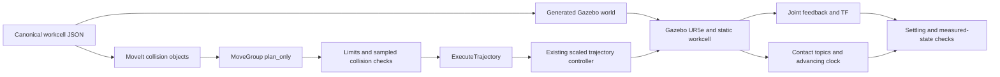

# VisionPick architecture

## Milestone 2 workcell

`config/workcell.json` defines the axis-aligned boxes once. The local workcell
launch generates an ignored SDF world and includes the installed UR control launch
with its supported `world_file` argument and the installed MoveIt launch once each.
The original Milestone 1 launcher, installed UR files and controller configuration
remain unchanged. No ACM collision exceptions are added.

`workcell_scene.py` waits for controller activation, discovers the live SRDF arm
group and planning frame, confirms the world-to-base transform, reads live Gazebo
geometry, and applies stable ADD IDs to MoveIt. Applying twice must produce the
same readback. IDs are `visionpick_table` and `visionpick_fixture`. A failed scene
initializer terminates the new launch with a startup error.



The new verifier reuses the existing Gazebo-only hardware guard, controller and
limit discovery, feedback ordering, freshness checks and logging. It requests 5%
velocity/acceleration scaling, validates returned derivatives and samples trajectory
segments at no more than 0.01 rad per joint. It executes that exact checked trajectory
through `/execute_trajectory`. Success requires measured motion, three fresh settled
samples spanning 0.2 simulation seconds, and error at most 0.02 rad relative to the
planned endpoint. Measured states are checked again at 0.01-rad displacement
intervals. These are discrete checks, not mathematically continuous collision detection.

The blocked target stays inside joint limits. State validity must identify the
fixture, planning must fail with no trajectory, and the same target must become
valid and plan successfully with only the fixture removed. That counterfactual plan
is never executed. Restoration is in a finally block and read back before motion.

Gazebo `scene/info` supplies live model poses; `generate_world_sdf` with expanded
includes supplies collision shapes omitted by the visual scene message. Synchronous
Gazebo queries use a short-lived helper interpreter to avoid blocking transport13
Python subscription callbacks. Contact publishers are discovered and monitored.
Harmonic publishes only nonempty contact sets, so clock liveness is checked separately;
zero contact messages alone do not prove collision freedom.

The workcell supervisor starts ROS in a private Linux session. Ctrl+C requests
normal shutdown, then cleans up remaining members of that session, checking process
start times before signalling. It contains leftovers without a global process-name kill;
the historical upstream destruction-time crash remains a limitation.

## Preserved Milestone 1 foundation

The official `ur_simulation_gz/ur_sim_moveit.launch.py` includes Gazebo control and
`ur_moveit_config`. No upstream configuration or installed file is modified.

```mermaid
flowchart LR
    RViz[RViz MotionPlanning] --> MoveIt[MoveIt move_group]
    Client[verify_motion.py] --> MoveIt
    Client --> Action[FollowJointTrajectory]
    MoveIt --> Action
    Action --> Controller[scaled_joint_trajectory_controller]
    Controller --> Plugin[gz_ros2_control GazeboSimSystem]
    Plugin --> Gazebo[Gazebo Harmonic UR5e]
    Gazebo --> Plugin
    Plugin --> JS[joint_state_broadcaster]
    JS --> Feedback[/joint_states]
    Feedback --> Client
    Feedback --> MoveIt
    Feedback --> RSP[robot_state_publisher]
    RSP --> TF[TF and TF static]
    Clock[Gazebo clock bridge] --> MoveIt
    Clock --> Client
```

Actual discovered endpoints:

- Controller manager: `/controller_manager`.
- Active controllers: `joint_state_broadcaster` and
  `scaled_joint_trajectory_controller` (`ur_controllers/ScaledJointTrajectoryController`).
- Active action: `/scaled_joint_trajectory_controller/follow_joint_trajectory`,
  type `control_msgs/action/FollowJointTrajectory`.
- MoveIt group: `ur_manipulator`; action `/move_action`; validity service
  `/check_state_validity`.
- Gazebo world/model: `empty` / `ur`; loaded hardware plugin:
  `gz_ros2_control/GazeboSimSystem`.
- RViz node: `/rviz2_moveit`, not `/rviz2`.

The unscaled action may appear in the ROS graph because MoveIt creates clients for
both configured controllers. An action name alone does not prove an active server.
The verifier queries controller lifecycle state, reads the actual controller joint
order, then checks the matching server. Joint-state order differs from controller
order and is explicitly remapped by name.

`verify_motion.py` has two execution modes. Direct mode sends bounded quintic joint
segments; MoveIt mode requests planning and execution with `plan_only=False`.
The direct verifier reads the live
`robot_description_planning.joint_limits.<joint>.max_acceleration` parameters
from move_group and bounds peak quintic acceleration by
`10/sqrt(3) * abs(delta) / duration²`, no greater than
`min(0.1, 0.1 * configured_limit)` rad/s². These are configured planning limits,
not manufacturer torque-derived physical guarantees.
Both sample joint feedback independently, reject stale/nonfinite data, require
movement and final settling, log timestamps and errors, and return nonzero on
failure. Direct motion also samples 21 intermediate states through MoveIt's
collision checker; this is not continuous collision checking.

Simulation-only checks require the live URDF's Gazebo hardware plugin, advancing
simulation time and fresh feedback. Independent Gazebo model/link queries in the
verification record distinguish these results from RViz-only animation. The passive
GUI observer sends no robot commands.

No middleware/global shell settings, shared ROS installation source, or other
project source was modified. Package installation used apt, without removing or
upgrading existing packages in the requested install operations.
